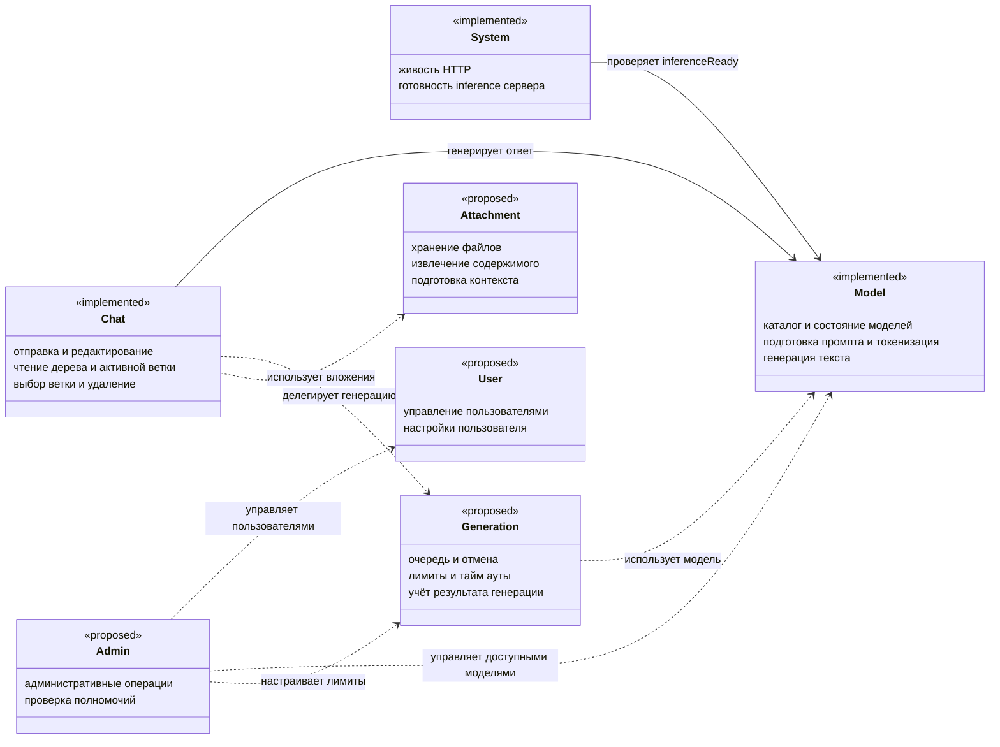
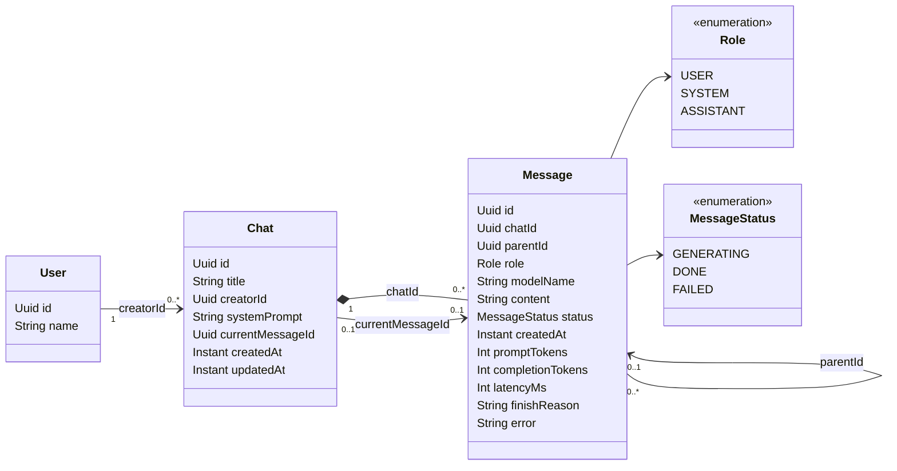
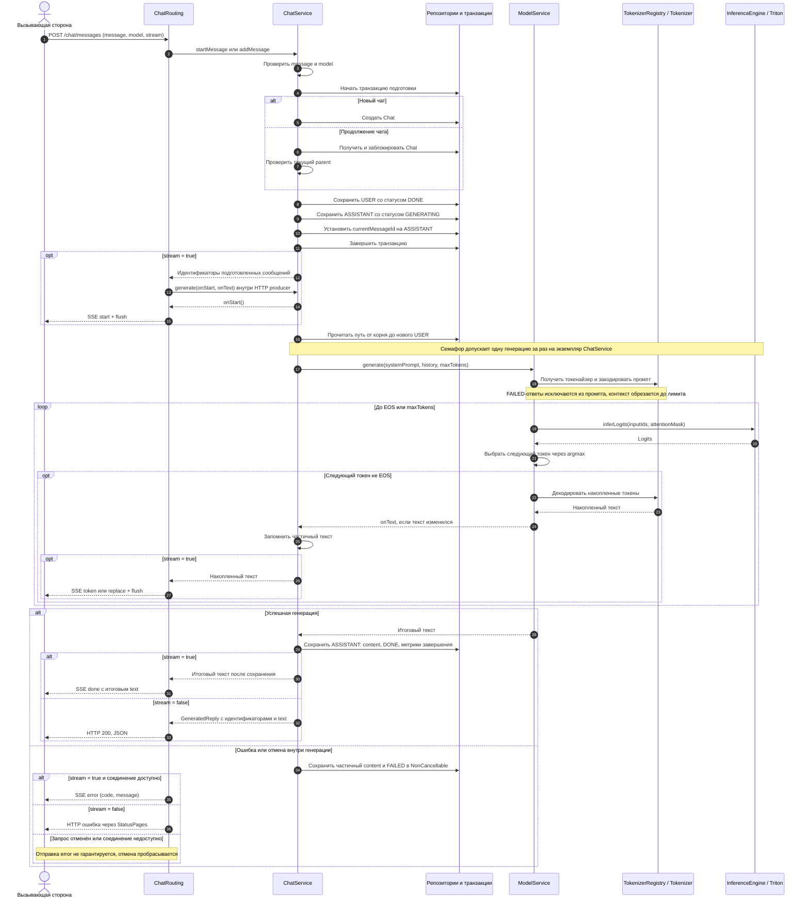
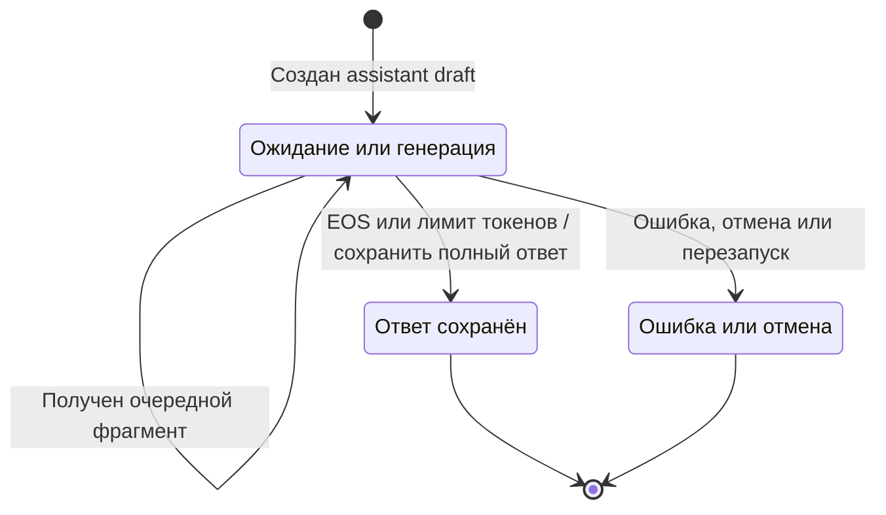
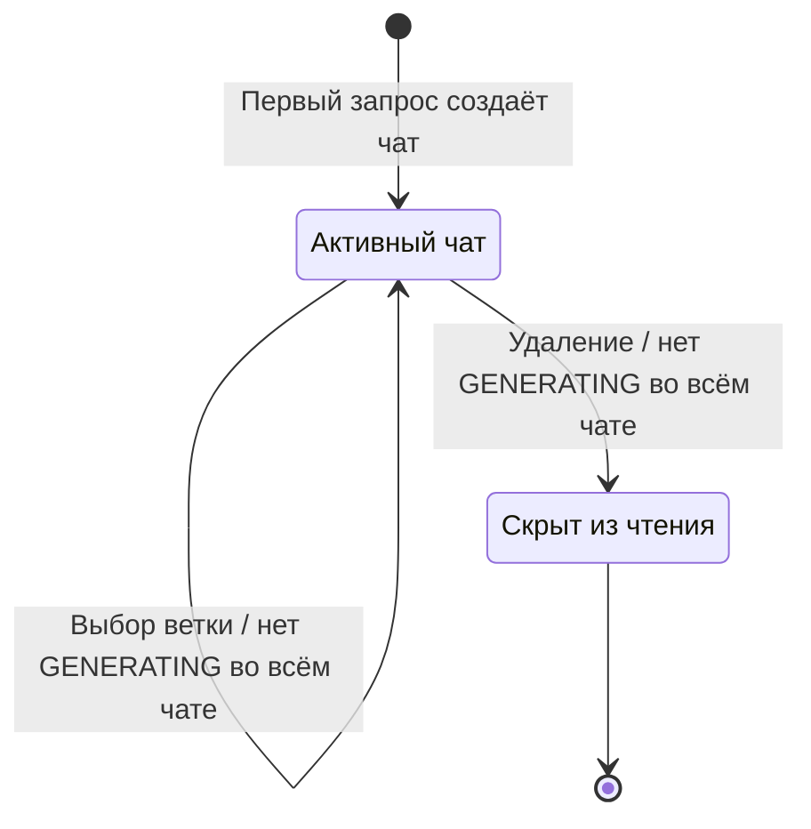

# Области сервиса и вопросы для обсуждения

Это описание текущих возможностей и предлагаемых границ. Оно не означает, что
все перечисленные функции реализованы. Ниже добавлены UML-диаграммы текущей бизнес-логики
и предлагаемых областей. Разбиение на Gradle-модули обсудим после согласования правил;
текущий проект остаётся в существующей структуре.

| Область | Уже реализовано | Следующие решения |
| --- | --- | --- |
| Chat | Отправка и SSE, ветвление при редактировании, чтение чатов/сообщений/ветки, переключение ветки, название и мягкое удаление | Повторная генерация ответа, отмена, ограничения размера истории и правила совместного доступа |
| Model | Каталог и состояние моделей, получение модели по имени, токенизация и greedy-генерация | Форматы промптов и EOS разных моделей, параметры генерации, ограничения контекста, автоматическая загрузка/выгрузка |
| System | Живость HTTP и доступность inference-сервера с тайм-аутом | Полная проверка зависимостей, метрики и эксплуатационная диагностика |
| User (предложение) | Есть доменная заготовка и таблица users с default user; API управления отсутствует | Создание/чтение/переименование/деактивация пользователя, настройки и связь с будущей авторизацией |
| Admin (предложение) | API и проверки полномочий пока отсутствуют | Пользователи, разрешённые модели, лимиты и настройки сервиса; UI появится с клиентом |
| Generation (предлагаемая отдельная ответственность) | Логика пока расположена в ChatService/ModelService: один inference за раз, streaming, сохранение результата/ошибки | Очередь, отмена, тайм-ауты, лимиты, учёт токенов и причина завершения |
| Attachment (позже) | Восстановлена доменная заготовка; загрузки в API нет | Хранение, связь с сообщениями, извлечение текста и включение в контекст модели |

## Текущие правила Chat

- Новый чат создаётся вместе с первым сообщением. userId по умолчанию — default user из миграции.
- При успешной обычной отправке, продолжении и редактировании возвращается обязательное поле
  `text` вместе с `chatId`, `userNodeId`, `assistantNodeId`. Текст совпадает с сохранённым ответом.
- Модель может сразу выдать EOS: тогда текст — пустая строка. Сервер не подменяет его выдуманным ответом.
- Некорректный запрос возвращает ошибку, а не фиктивный успешный ответ.
- SSE возвращает start, token/replace и done с итоговым текстом. Ошибка после начала SSE
  передаётся событием error; частичный ответ сохраняется как failed.
- GET сообщений чата возвращает всё дерево с parentId; GET history — только активную ветку.
- Активную ветку можно выбрать по assistant-сообщению этого чата. DONE и FAILED допустимы;
  GENERATING нельзя выбрать. Частичный FAILED-ответ не включается в промпт модели.
- При генерации нельзя продолжить незавершённую текущую ветку. Если в любой ветке чата
  есть генерация, нельзя переключить активную ветку или удалить чат: ответ 409.
  Редактирование более раннего сообщения может создать независимую новую ветку.
- Удаление мягкое: чат исчезает из списков и чтения, сообщения сохраняются в БД.
- userId сейчас является параметром фильтра, а не доказательством личности или проверкой доступа.
- Обычный JSON-режим сохраняется до решения о переходе клиента только на SSE. Сейчас он не deprecated.

## User и Admin

User отвечает за пользовательскую запись и настройки; авторизация подтверждает,
кто отправляет запрос; проверка доступа определяет разрешённые действия.
Это связанные, но разные задачи. Управление пользователями можно добавить отдельным API,
но его правила создания и удаления нужно согласовать с существующими чатами.

ADMIN_ID из окружения может назначать административную роль подтверждённому пользователю.
Один UUID не подтверждает личность: сравнение с userId из тела/заголовка запроса
позволит любому указать административный UUID. Поэтому не выдаём админские полномочия
только по клиентскому UUID. Для временного локального режима возможна отдельная админская
учётная информация; для обычного приложения — подтверждённая идентичность и роли.
Это выбор для обсуждения, механизм авторизации в этой итерации не добавлен.

Admin — интерфейс административных сценариев, а не отдельное хранилище всех бизнес-данных.
Он вызывает операции User/Model/Generation с проверкой полномочий. System содержит
техническое состояние, а не управление пользователями и моделями.

## Что ещё нужно до полноценного текстового приложения

1. Проверить всю цепочку PostgreSQL → токенайзер → настоящий Triton → SSE с выбранной моделью.
2. Согласовать шаблоны диалогов, EOS, параметры и лимиты контекста каждой модели.
3. Определить отмену и повторную генерацию: статус, сохранение частичного текста,
   поведение очереди и ограничение числа ожидающих запросов.
4. Согласовать идентификацию пользователей, роль ADMIN_ID, доступ к чатам и API управления.
5. Определить ограничения/пагинацию дерева сообщений и полную проверку зависимостей.
6. После согласования уточнить UML ниже и обсудить зависимости Gradle-модулей.

Файлы, клиент и модульный монолит в этой итерации не реализуются.

## UML: области и их ответственность

Концептуальная диаграмма областей. Это не список существующих классов или Gradle-модулей.
Стереотип `implemented` обозначает работающую область, `proposed` — предложение.
Зависимости предложенных областей показаны пунктиром. Generation сейчас находится
в ChatService и ModelService; отдельная область пока не выделена.

User и Admin пока не имеют ручек. UUID пользователя сейчас связывает запись пользователя
и чат, но не подтверждает личность. Проверка ADMIN_ID должна опираться на будущий
механизм идентификации; сам такой механизм на диаграмме не объявлен реализованным.

## UML: сущности чата и дерево сообщений

Диаграмма отражает текущие сущности и связи по UUID. Связь creatorId поддержана внешним
ключом в БД; остальные показанные связи между Chat/Message также существуют в схеме.
Мягкое удаление хранится в таблице chats как deleted_at, но отдельного поля в классе Chat нет.

У currentMessageId, parentId и modelName допустим null; метрики и поля ошибки также
необязательны. parentId связывает дочернее сообщение с одним родителем в том же чате.
В коде каждый новый чат сразу получает пару USER → ASSISTANT. В схеме допускается
отсутствие активного узла; схема и класс также допускают роль SYSTEM, но отправка
сообщения сейчас создаёт только USER и ASSISTANT.

При редактировании новый USER получает parentId исходного USER: исходный узел
и новый узел становятся соседними ветками. Затем создаётся новый ASSISTANT, который
становится currentMessageId. Исходные сообщения сохраняются. Поэтому отдельной сущности
Branch сейчас нет: ветка определяется цепочкой parentId и указателем currentMessageId.

## UML: отправка сообщения и поток ответа

Показан успешный путь и обработка ошибки после начала генерации. Repo — условное
обозначение ChatRepository/MessageRepository, Engine — InferenceEngine, реализованный
TritonEngine. HTTP-обработчик и SSE находятся в ChatRouting. Транзакция подготовки
заканчивается до обращения к модели; ожидание и inference не удерживают транзакцию БД.

Для обычного режима startMessage вызывается внутри addMessage, а generate — сразу после
подготовки. Для SSE маршрут сначала получает подготовленные идентификаторы, затем вызывает
generate внутри производителя HTTP-ответа. Событие start отправляется callback-ом onStart.
На диаграмме эти два пути объединены, чтобы показать общую бизнес-логику.

Ошибки валидации/поиска/конфликта до подготовки ответа сохраняют HTTP-статусы 400/404/409.
В SSE start ещё не содержит текст; token содержит новый фрагмент, replace — исправленный
накопленный текст, done — итоговый текст. Генерация может завершиться по EOS без единого token.
В этом случае done.text и text обычного ответа равны пустой строке.

## UML: состояния сообщения и чата

Состояния ASSISTANT соответствуют MessageStatus. GENERATING включает ожидание семафора
и сам inference: отдельного статуса QUEUED сейчас нет. Ошибка сохраняет уже полученный
текст. При перезапуске сервера оставшиеся GENERATING переводятся в FAILED.
Во время работы частичный текст накапливается в памяти и записывается при завершении
или обработанной ошибке; аварийный перезапуск не восстанавливает несохранённые фрагменты.
Из метрик сейчас заполняются latencyMs и finishReason, а promptTokens и completionTokens — null.

USER создаётся сразу в DONE. Переходы DONE → GENERATING и FAILED → GENERATING сейчас
не выполняются: редактирование создаёт новые узлы. Отдельный статус CANCELLED и операция
повторной генерации пока не реализованы.

Мягкое удаление чата — отдельное состояние хранения, не MessageStatus:

При наличии GENERATING в любой ветке переключение ветки и удаление возвращают 409,
состояние чата не меняется. Восстановление удалённого чата через API пока отсутствует.
